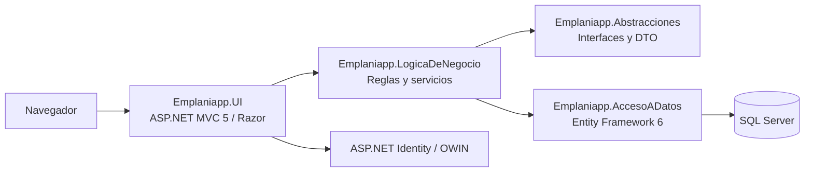

# EMPLANIAPP | Employee & Payroll Management System

**EMPLANIAPP** es una aplicación web de gestión de empleados y procesos de planilla desarrollada con **ASP.NET MVC 5, C#, .NET Framework 4.8.1, Entity Framework 6 y SQL Server**. Está organizada en capas para separar presentación, contratos, lógica empresarial y acceso a datos.

> **English summary:** Academic employee and payroll management portfolio application built with ASP.NET MVC 5, C#, .NET Framework 4.8.1, Entity Framework 6, SQL Server, ASP.NET Identity and OWIN. It includes employee records, compensation/deductions, payroll summaries, liquidation workflows, audit history, dashboard indicators and PDF reports. **Local demo only; not a deployed or certified payroll product.**

## Funcionalidades presentes en el repositorio

| Área | Módulos de código |
| --- | --- |
| Empleados | Registro, consultas, edición/estado, filtros y datos personales |
| Planilla | Periodos de pago, hoja resumen, aprobación y reportes |
| Remuneraciones y retenciones | Altas, edición, consultas y eliminación de conceptos |
| Liquidaciones | Gestión de datos y procesos de liquidación |
| Dashboard | KPIs, estados y visualización de salarios |
| Reportes | Recibos y exportaciones PDF |
| Seguridad | Login, ASP.NET Identity, autorización y recuperación de contraseña |
| Historial | Consulta, filtros y registro de eventos |

**Alcance honesto:** estas características existen en controladores y vistas. El repositorio todavía **no contiene una base de datos reproducible ni pruebas funcionales completas**; no se afirma que los cálculos cumplan normativa laboral vigente ni que la aplicación esté lista para operar planillas reales.

## Arquitectura

| Proyecto | Responsabilidad |
| --- | --- |
| `Emplaniapp.UI` | Controladores MVC, vistas Razor, autenticación, dashboard |
| `Emplaniapp.Abstracciones` | Modelos, DTO e interfaces |
| `Emplaniapp.LogicaDeNegocio` | Lógica y coordinación de casos de uso |
| `Emplaniapp.AccesoADatos` | Contexto y persistencia SQL / EF 6 |

La solución principal está en `Emplaniapp.sln`. Hay un proyecto/carpeta adicional `Abstracciones/` que no forma parte de los cuatro proyectos principales de la solución.

## Stack

**C# · ASP.NET MVC 5 · .NET Framework 4.8.1 · Razor · Entity Framework 6.5.1 · SQL Server · ASP.NET Identity · OWIN · HTML/CSS/JavaScript · Bootstrap.**

## Ejecutar localmente

**Requisitos:** Windows, Visual Studio 2022 con herramientas de desarrollo web de ASP.NET y targeting pack .NET Framework 4.8.1, NuGet y SQL Server.

1. Clonar este repositorio y abrir `Emplaniapp.sln` en Visual Studio.
2. Restaurar los paquetes NuGet y compilar la solución (Debug o Release).
3. Configurar una **base de datos de pruebas compatible** con el esquema de EMPLANIAPP. Los valores `DefaultConnection` y `Contexto` están en `Emplaniapp.UI/Web.config` y utilizan conexión Windows local.
4. Ejecutar `Emplaniapp.UI` mediante IIS Express y comprobar el login con una cuenta ficticia.

**Limitación:** el esquema SQL / DACPAC / script de creación no está incluido actualmente. El repositorio **no permite recrear desde cero una instalación funcional con una sola orden**. No publiques copias de bases reales ni información de colaboradores.

## Recuperación de contraseña y seguridad SMTP

`Emplaniapp.UI/App_Start/EmailService.cs` usa `System.Net.Mail.SmtpClient`. **Las credenciales SMTP se leen del entorno del proceso**, nunca del `Web.config` almacenado en Git.

| Variable | Uso |
| --- | --- |
| `EMPLANIAPP_SMTP_USERNAME` | Usuario SMTP |
| `EMPLANIAPP_SMTP_PASSWORD` | Contraseña de aplicación SMTP |
| `EMPLANIAPP_MAIL_FROM` | Remitente opcional (si falta, se usa el usuario SMTP) |

El host/puerto/TLS del proveedor permanecen en la sección `system.net/mailSettings` sin credenciales. Visual Studio debe iniciarse desde un entorno que reciba estas variables. No las guardes en commits, capturas ni documentación.

**Acción de seguridad necesaria:** una versión anterior del repositorio público incluyó una contraseña SMTP. **Revócala o sustitúyela en el proveedor de correo**. Borrarla de la versión actual **no** la elimina del historial de Git.

## Calidad y estado

| Comprobación | Estado |
| --- | --- |
| Código MVC / lógica / acceso SQL | Presente |
| Restauración/compilación automatizada | Workflow Windows incluido; consultar [Actions](../../actions/workflows/build.yml) para resultado |
| Pruebas automatizadas | No hay proyecto de pruebas encontrado |
| Pruebas end-to-end en instalación nueva | Pendientes |
| Scripts SQL de inicialización | Pendientes de aportar |
| Capturas de funcionamiento real | Pendientes |
| Demo pública / Azure | **No disponible ni verificada** |

La compilación no garantiza funcionamiento, autorización correcta ni integridad de cálculos. EMPLANIAPP es una **demo local de portafolio**, no una aplicación de producción.

## Próximos pasos

Consulta el [checklist de validación y capturas](docs/PORTAFOLIO_Y_VALIDACION.md) para cerrar las pruebas con datos ficticios, documentar la base SQL, tomar evidencias reales y revisar seguridad antes de cualquier despliegue.

## Autor

**Henry González Alguera** — Proyecto académico / portafolio de desarrollo de software.

[Perfil de GitHub](https://github.com/HenryGonzalezAlguera) · [Repositorio](https://github.com/HenryGonzalezAlguera/Emplaniapp)
